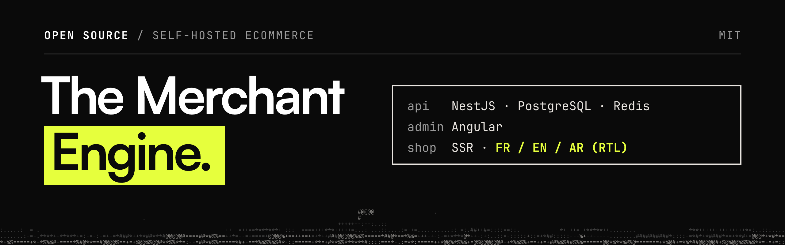
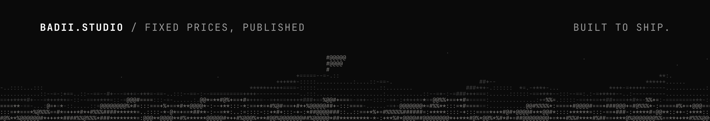

<a href="https://badii.studio">
  
</a>

<p>
  <a href="https://badii.studio"></a>
  <a href="https://calendly.com/badii-studio"></a>
  <a href="mailto:badii@badii.studio"></a>
</p>

### Hi, I'm Badii Boutar.

Senior full-stack engineer with 7+ years of experience. I run **[badii.studio](https://badii.studio)**: I take apps built with Lovable, Bolt, Replit, Base44, v0, Cursor and Claude Code from *almost works* to launched, secure and paying.

I work alone, so the person you talk to is the person who does the work. I use Claude Code every day, which is how I know where AI-generated code breaks.

```txt
$ whoami
name      Badii Boutar
studio    badii.studio
based     Tunisia · CET (UTC+1)
online    09:00 to 20:00 CET
overlap   full EU day · US East Coast mornings
stack     NestJS · Node/TypeScript · PostgreSQL · Prisma · Supabase · Angular · React/Next.js · Stripe
```

### What I check and fix

- Supabase row-level security that is off, or lets any user read every row
- Auth flows, sessions and password reset links that point to localhost
- Secret keys in the client bundle or the repo
- Stripe payments and webhooks that never update the database
- Deploy, custom domains, CI, backups and monitoring

### Fixed, published prices

```txt
00   Free Teardown         free           48h
01   Launch Audit          $490           3 business days
01b  Quick Fix             $750           3 business days
02   Fix & Launch Sprint   from $2,500    1 to 3 weeks
04   MVP Build             from $8,000    4 to 6 weeks
--   Care                  from $750 / month
```

If the audit doesn't find at least 5 concrete, actionable issues, it's free. Full details on **[badii.studio/pricing](https://badii.studio/pricing)**, or **[request a free teardown](https://badii.studio/#teardown)**.

<br>

<a href="https://themerchantengine.com">
  
</a>

**[The Merchant Engine](https://github.com/xdabier/themerchantengine)** is my open-source, self-hosted ecommerce platform: NestJS API, Angular admin, SSR storefront, FR/EN/AR with RTL, cash on delivery and a one-command install. MIT licensed.

<p>
  <a href="https://github.com/xdabier/themerchantengine"></a>
  <a href="https://themerchantengine.com"></a>
  <a href="https://badii.studio/themerchantengine"></a>
</p>

Want it running without the setup? I launch it from $1,490, migrate your Shopify or WooCommerce store, run it from $390 a month, or white label it for your agency.

### Writing

- [How much does it cost to fix a Lovable app?](https://badii.studio/cost-to-fix-lovable-app) · [dev.to](https://dev.to/badii_studio/how-much-does-it-cost-to-fix-a-lovable-app-37p7) · [Hashnode](https://badii-studio.hashnode.dev/how-much-does-it-cost-to-fix-a-lovable-app) · [Medium](https://medium.com/@bbadii/how-much-does-it-cost-to-fix-a-lovable-app-52206dca2df0) · [Indie Hackers](https://www.indiehackers.com/post/how-much-does-it-cost-to-fix-a-lovable-app-i-checked-real-2026-prices-be73650b65)
- [Is my Supabase app leaking data between users?](https://badii.studio/supabase-rls-audit) · [dev.to](https://dev.to/badii_studio/is-my-supabase-app-leaking-data-between-users-5b27) · [LinkedIn](https://www.linkedin.com/pulse/my-supabase-app-leaking-data-between-users-badii-boutar-vrs5e/)
- [Why isn't my Stripe webhook updating Supabase?](https://badii.studio/stripe-webhook-not-updating-supabase)
- [What if my Supabase service_role key is in the front end?](https://badii.studio/supabase-service-role-key-exposed)
- [Why do my password reset emails link to localhost?](https://badii.studio/password-reset-link-localhost)
- [Why does my app work in preview but break on my custom domain?](https://badii.studio/app-breaks-on-custom-domain)
- [Should an agency, a freelancer, Fiverr or I fix my AI-built app?](https://badii.studio/agency-vs-freelancer-vs-fiverr)

Platform guides: [Lovable](https://badii.studio/lovable) · [Bolt](https://badii.studio/bolt) · [Replit](https://badii.studio/replit) · [Base44](https://badii.studio/base44) · [v0](https://badii.studio/v0) · [Cursor](https://badii.studio/cursor) · [all guides](https://badii.studio/guides)

### Find me

<p>
  <a href="https://www.linkedin.com/in/badiiboutar"></a>
  <a href="https://dev.to/badii_studio"></a>
  <a href="https://badii-studio.hashnode.dev"></a>
  <a href="https://medium.com/@bbadii"></a>
  <a href="https://badii.studio/guides"></a>
</p>

<a href="https://badii.studio">
  
</a>
